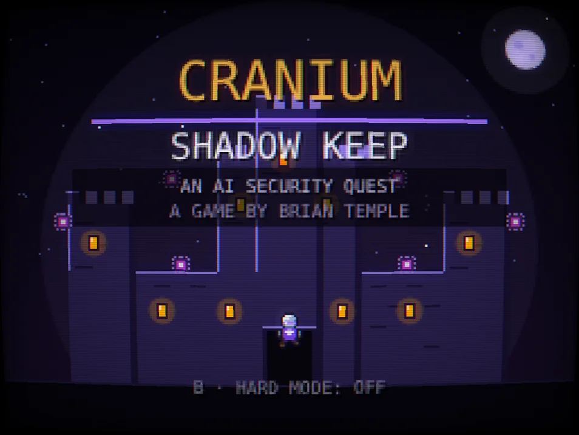
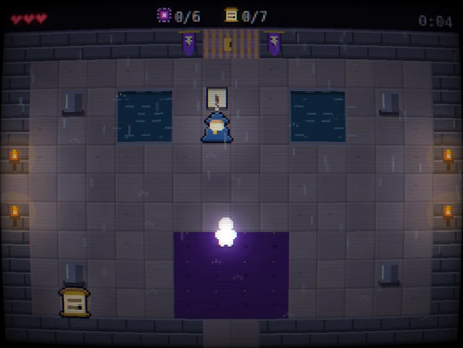
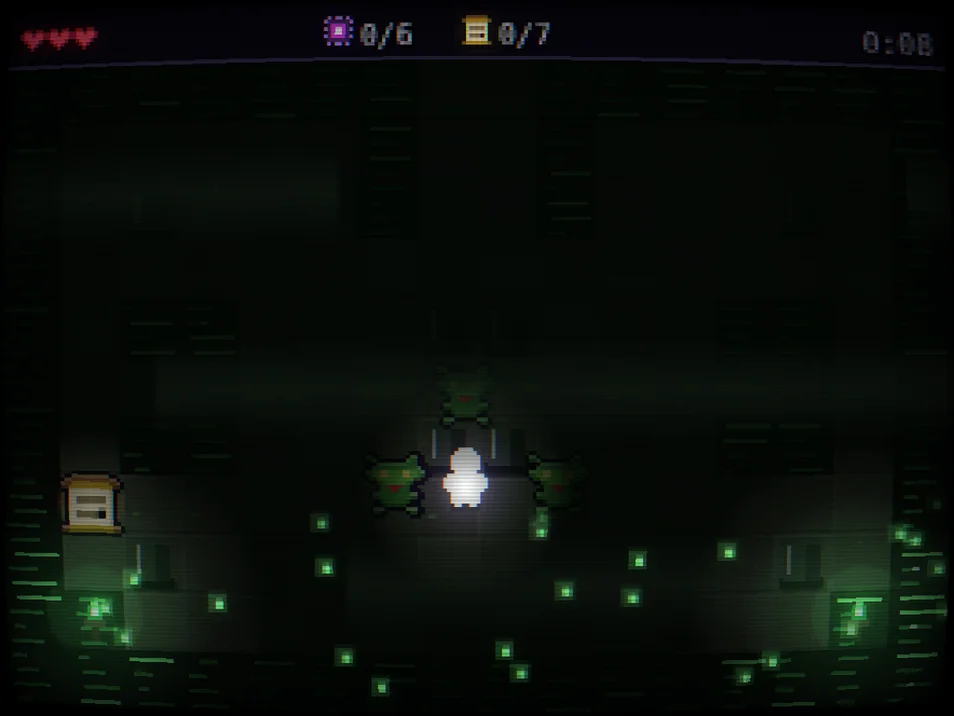
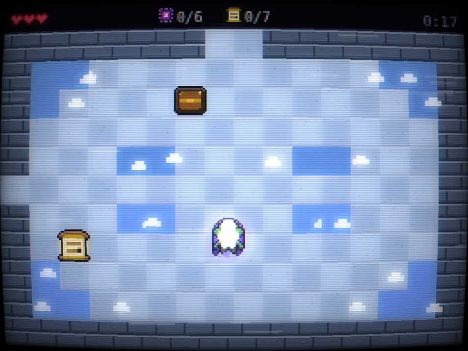
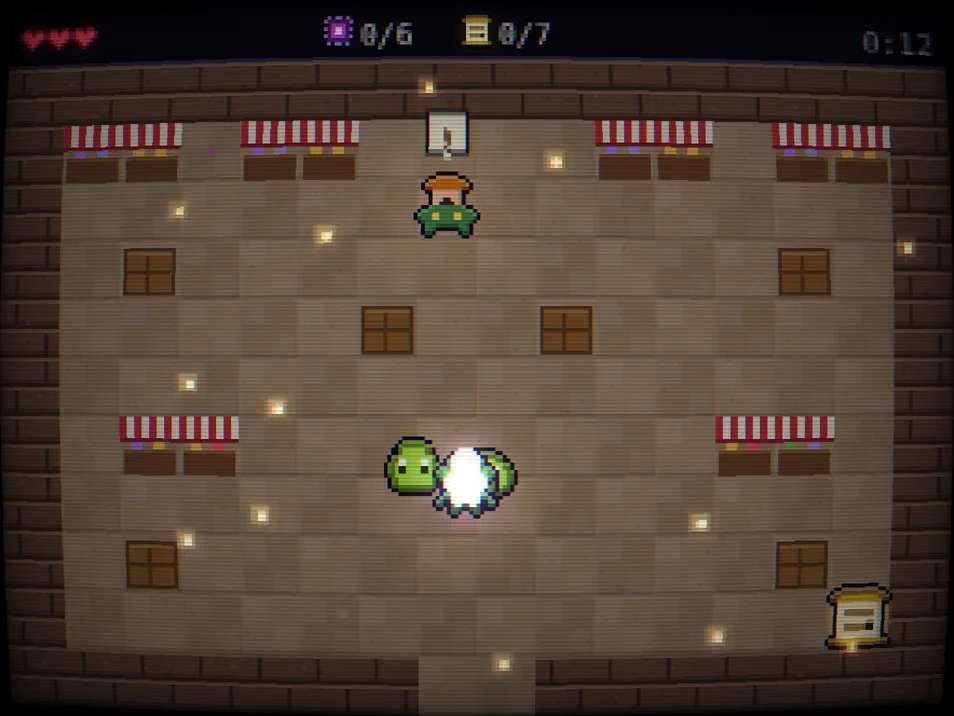
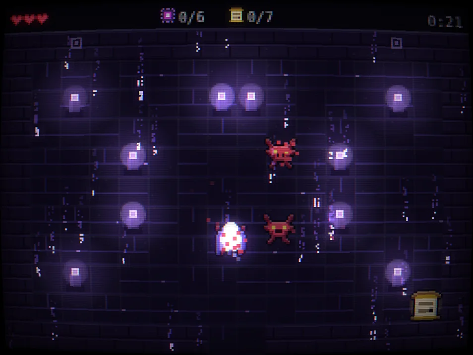
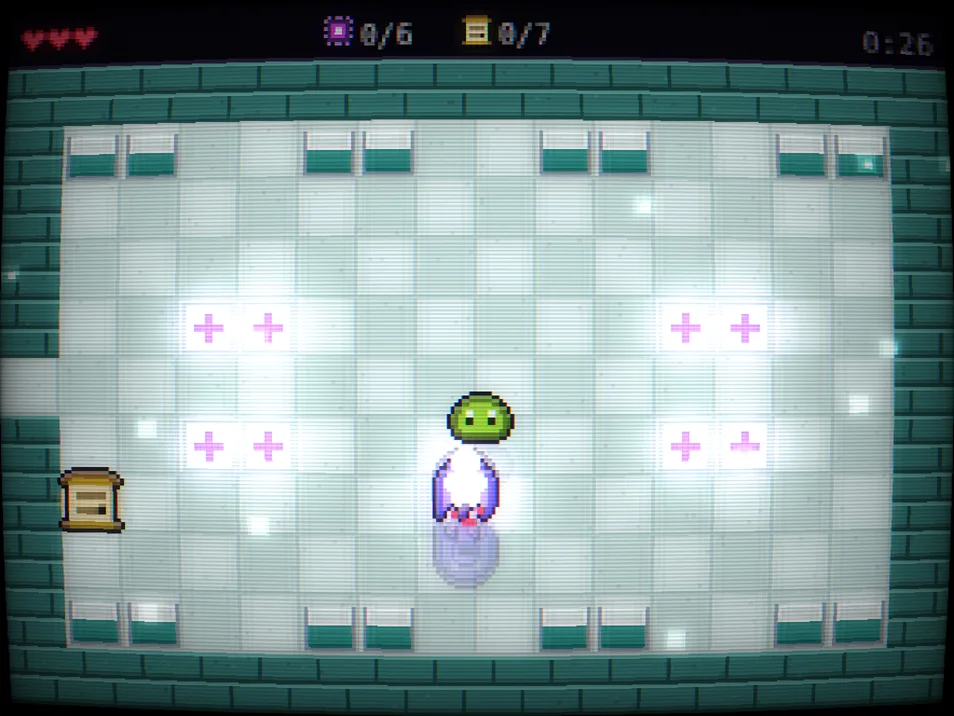
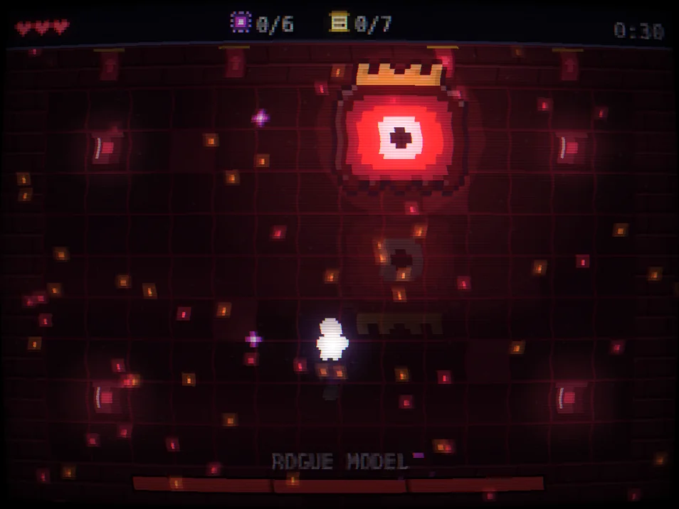

# Shadow Keep

**▶ Play it:** [templeofdoom085.github.io/shadow-keep](https://templeofdoom085.github.io/shadow-keep/) · runs in any browser, phone or laptop, no install

<p align="center"></p>

A 16-bit style AI security quest themed around Cranium. Shadow AI has slipped into the kingdom's
code, cloud, vendors, agents, bank and hospital. Find it, validate the vendor line, then red team
the Rogue Model and the Supply Chain Hydra in the Arena.

Designed and built by [Brian Temple](https://templeofdoom085.github.io).

## Screenshots

| | |
|---|---|
|  **Cranium Citadel** · the hub, where the High CISO hands you the Discovery Lantern |  **Code Catacombs** · shadow AI hiding in a Python repo, lit only by your lantern |
|  **The Cloud Keep** · an unsanctioned model in a cloud function |  **Vendor Bazaar** · third-party AI tucked inside vendor plugins |
|  **The Agent Spire** · rogue agents and prompt-injection goblins |  **The Hospital Wing** · HIPAA-regulated AI in a clinical setting |

<p align="center"><br><b>The Arena</b> · red team the Rogue Model through three phases</p>

## What's in it

- **Nine rooms, two bosses.** Six zones of hidden shadow AI, the Vendor Gate mini-game, the Rogue Model and the Supply Chain Hydra.
- **Real-world grounding.** Rooms surface sourced stats (IBM Cost of a Data Breach 2025, EU AI Act penalties) and scrolls for the EU AI Act, NIST AI RMF, ISO 42001, MITRE ATLAS, OWASP LLM Top 10, SR 11-7 and HIPAA.
- **Live team leaderboard.** Scores post to Supabase with row-level security, plus server-side triggers that reject implausible or cheated runs.
- **Hand-rolled engine.** Vanilla JavaScript and Canvas, a WebGL post-process pass (CRT curve, bloom), procedural chiptune audio, touch controls with a slide-to-aim D-pad. No framework, no game engine.
- **Tested.** A headless test suite drives the game loop directly (`npm test`).

## Controls

| Keyboard | Phone | Action |
|---|---|---|
| Arrow keys | D-pad | Move |
| Z | A | Talk, strike, charge |
| X | B | 360° spin attack |
| Space | Scan | AgentSensor scan / advance dialogue |

## Layout

```
shadow-keep/
  screenshots/      README images
  index.html        built game (what GitHub Pages serves; don't edit by hand)
  build.mjs         builds index.html (GitHub) and dist/claude/ (claude.ai artifact)
  src/              the actual source, concatenated in the order listed in src/ORDER
    head.html, body.html, styles.css   page shell
    00-setup.js     canvas + WebGL post-processing (CRT curve, bloom)
    01-intel.js     sourced industry stats shown in rooms
    02-sprites.js   all sprite art (16-bit style via hd())
    03-audio.js     sound effects + reactive chiptune
    04-world.js     rooms, maps, enemies, vendors, Cranium room facts
    05-state.js     new-game state
    06-input.js     keyboard, touch buttons, slide-to-aim D-pad
    07-helpers.js   collision, particles, text wrap
    07b-messages.js the single pop-up queue (facts, tips, announcements)
    08-player.js    movement, room changes, boss intros
    09-hydra.js     Supply Chain Hydra boss
    10-combat.js    damage, Rogue Model phases, attacks
    11-vendor.js    Vendor Gate mini-game
    12-update.js    main game loop logic
    13-score.js     scoring, progress scores, personal bests
    14-draw.js      all rendering (tiles cached per room, lighting, screens)
    15-online.js    leaderboard, lead capture, share card
    16-loop.js      frame loop + test hook
  tests/run.mjs     headless test suite (no browser needed)
```

## Commands

```
npm run build   # rebuild index.html and the claude.ai version
npm test        # build + run the test suite
```

## Leaderboard

The GitHub build posts to Supabase (`scores` and `leads` tables). The publishable key in
`build.mjs` is meant to be public: row-level security only allows reading/adding scores and
adding leads (leads can't be read back from the browser). Database triggers reject
implausible scores (too-fast clears, oversized progress scores, spam) and bad emails.
View leads in Supabase under Table Editor → leads.
